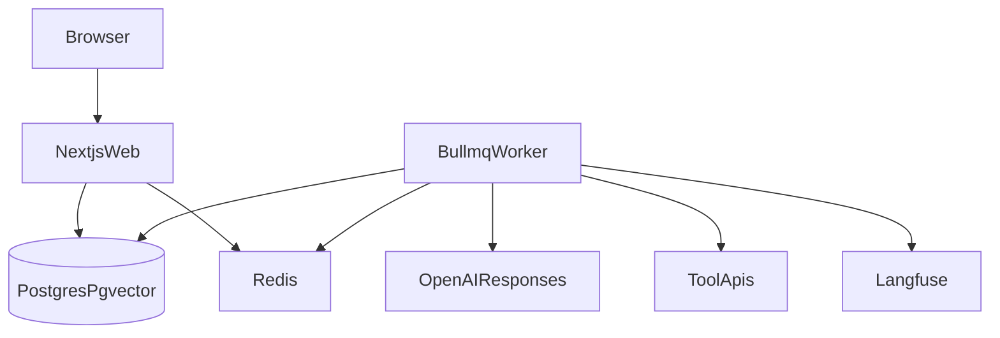
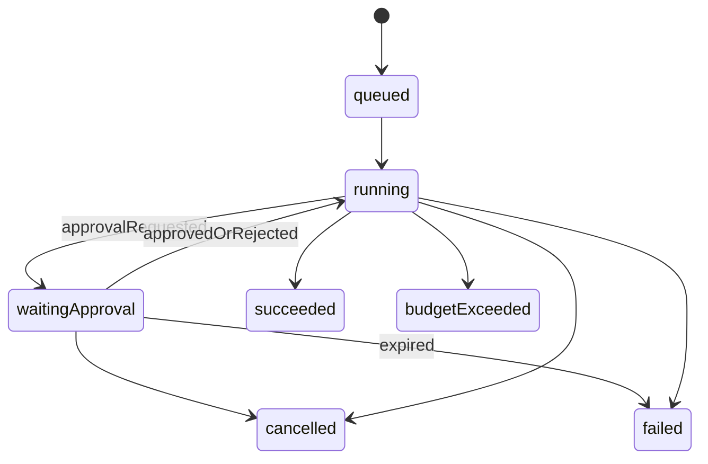
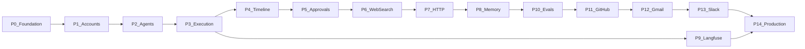

# Orvia Implementation Roadmap

The workspace currently contains only [README.md](README.md). There is no application, schema, or infrastructure to extend. Each phase below is one implementation cycle: its tests and acceptance criteria pass before the next phase starts.

## 1. Product understanding

Orvia is a multi-user workspace for defining, running, and supervising general-purpose agents. A person signs up, creates an agent, sets instructions and limits, enables tools, submits a natural-language task, watches the run, approves protected actions, inspects the result, and reuses the agent with persistent memory.

The product has two parts that must stay consistent:

- The workspace is the authenticated UI and HTTP API for configuration, monitoring, approvals, memory, and history.
- The execution infrastructure runs tasks outside the browser request, persists every step, and can resume after a worker crash or a human decision.

Agents are user-defined records, not a fixed catalog. The first release has one OpenAI model for every agent. Usage limits exist from the first real model call. Multi-agent collaboration, a visual workflow builder, a marketplace, fine-tuning, user-supplied code execution, multiple model providers, teams, and payments stay out of the build.

Milestone A, after Phase 8, is a usable workspace: accounts, versioned agents, durable runs, a live trace, approvals, web search, controlled HTTP, and memory. Milestone B, after Phase 10, scores that core behavior across versions. Milestone C, after Phase 13, adds GitHub, Gmail, and Slack. Milestone D, after Phase 14, is the deployed system passing the full verification drill.

## 2. Architecture

**App shape.** A pnpm workspace on Node.js 22:

- [apps/web](apps/web) — Next.js 16 App Router, Tailwind, account and workspace UI, authenticated API routes. No agent loop runs here.
- [apps/worker](apps/worker) — long-running BullMQ worker. This is the only process that calls `ToolLoopAgent`.
- [packages/core](packages/core) — runner, tools, approvals, memory, budgets, redaction, and the eval adapter. Both processes import it.
- [packages/db](packages/db) — Prisma schema, migrations, and client.
- [packages/config](packages/config) — Zod-parsed environment, split into shared, web, and worker schemas so a process fails fast on the variables it actually needs.
- [evals](evals) — Promptfoo configs and the engineering fixture.

**Decisions that fix the stack in place.**

- The Vercel AI SDK runs self-hosted inside the worker. The app is not deployed to Vercel, because a durable BullMQ worker needs a long-lived process and the VM is the deployment target.
- Better Auth provides email and password accounts in the same Postgres database. Sessions live in Postgres, so flushing Redis does not sign everyone out. There is no paid identity vendor.
- One user owns one private workspace. Every domain row carries `userId`. Repositories take that id on every query. A missing or foreign row returns not found.
- The platform model is `openai.responses(process.env.OPENAI_MODEL)`. The default is `gpt-6-luna`. OpenAI's model and pricing pages on 11 Nov 2026 list it as available, with function calling and web search on the Responses API, at $0.10 per 1M input tokens, $0.01 per 1M cached input tokens, and $0.50 per 1M output tokens. Requests above 272K input tokens use the higher long-context rates on that pricing page. `gpt-5-nano` is listed cheaper, at $0.05 / $0.40, and it supports tools, but OpenAI's deprecation page schedules its shutdown for 11 Dec 2026, so it is not the roadmap default. Every agent uses this one configured model. The model id is snapshotted onto the agent version. Initial calls set `reasoning.effort` to `none` so development runs do not spend reasoning tokens, and temperature is sent in that mode. CI and deterministic tests use the AI SDK mock model. A live Phase 3 smoke is the point that can raise `OPENAI_MODEL` or reasoning effort, and only when that run shows the default is inadequate. There is no model picker and no second provider.
- Embeddings use `text-embedding-3-small` (1536 dimensions, about $0.02 per 1M tokens) through `OPENAI_EMBEDDING_MODEL`.
- User-facing traces are Postgres rows. Langfuse is the operator console. If Langfuse is down or unset, the run still completes and the workspace timeline still works.
- `ToolLoopAgent` is the agent loop. It can stop on a `tool-approval-request` and continue when the next `generate()` call receives the prior messages plus a `tool-approval-response`. It does not persist checkpoints. The worker saves the SDK message list after every step and resumes from that list. `WorkflowAgent` and the Workflow DevKit stay out: they would add a second orchestration runtime beside BullMQ, and the self-hosted workflow Postgres world is a reference implementation whose control routes are unauthenticated.

**Workspace routes.**

- `/sign-up`, `/sign-in`, `/forgot-password`
- `/agents`, `/agents/new`, `/agents/[id]` with instructions, tools, memory, limits, approvals, and versions
- `/executions`, `/executions/[id]`
- `/approvals`, `/memories`, `/connections`, `/usage`
- `/evaluations`, `/evaluations/[id]`

Progress is a stream of persisted step events over SSE, woken by Redis pub/sub, with a two-second poll fallback. Token-by-token chat streaming is not part of the design; the step log remains the source of truth after the browser disconnects.

## 3. Data model

Better Auth owns `user`, `session`, `account`, and `verification`. Domain tables reference `user.id` and live in the same Prisma schema. Postgres 17 uses the `pgvector/pgvector` image. The `vector` extension is enabled in the first migration; the embedding column arrives with memory.

**Agents**

- `Agent`: id, userId, name, description, archivedAt, currentVersionId
- `AgentVersion`: immutable snapshot with versionNumber, instructions, model id, model settings, tool config, memory config, limits, approval policy, createdAt. An execution stores `agentVersionId` and keeps using that snapshot after later edits.

Archiving is the user-facing delete. Past executions stay readable. Memories are removed with the agent only when the user confirms that cascade.

**Runs**

- `Execution`: userId, agentId, agentVersionId, task, status, leaseOwner, leaseExpiresAt, fencingToken, heartbeatAt, cancelRequestedAt, budgetReservedTokens, budgetHoldStatus (`none | open | unresolved`), finalText, safe error code, reconciled token totals, estimated cost, langfuseTraceId, timestamps
- `ExecutionCheckpoint`: executionId, stepIndex, SDK `ModelMessage[]`, schema version. Append-only. Resume loads the highest step.
- `ExecutionStep`: the visible projection — model, tool, approval, memory, error, or retry — with redacted input and output, token counts, latency, and timestamps
- `ExternalEffect`: unique `toolCallId`, optional `idempotencyKey` (set only when that provider deduplicates replays), status `reserved | succeeded | failed | uncertain`, request hash, redacted result. A null key means at-most-once dispatch: `reserved` and `uncertain` are not dispatched again.
- `Approval`: tool name, redacted proposed input, status `pending | approved | rejected | expired`, decision, comment

Execution status moves only as follows:

**Connections and memory**

- `Connection`: user-owned, provider `http | github | gmail | slack`, label, status, scopes, external account id, token expiry. Agents are granted connection ids in their tool config. One user may connect two accounts of the same provider.
- `Secret`: encrypted payload for that connection. The client receives status, label, and scopes only.
- `MemoryItem`: userId, agentId, content, kind, embedding `vector(1536)`, status `proposed | accepted | rejected`, provenance (`sourceExecutionId`, `sourceStepId`, createdBy `agent | user`), timestamps, deletedAt

**Controls and evals**

- `UserBudget`: monthly token cap, concurrent-run cap, consumedTokens, reservedTokens (open and unresolved holds both count), and the current period start
- `UsageRecord`: one row per execution, with input, output, cached, and reasoning tokens, tool-call counts, and estimated USD
- `EvaluationDataset`, `EvaluationCase`, `EvaluationRun`, `EvaluationCaseResult`. A run is pinned to an agent version. A case result points at the execution it produced.

Prices live in [packages/core/src/pricing.ts](packages/core/src/pricing.ts) for the configured model and the embedding model. Raw token counts are stored either way. Estimated cost is labeled as an estimate. A test fails if `OPENAI_MODEL` has no price entry.

## 4. Execution, approval, and safety protocol

Submitting a task writes an `Execution` in `queued`, pins the current agent version, and enqueues a BullMQ job whose id is the execution id. A worker runs that job only after it acquires the database lease: `leaseOwner`, `leaseExpiresAt`, and a monotonic `fencingToken` that increments on each new acquisition. Acquisition succeeds when the execution has no lease or the current lease has expired. Heartbeats extend `leaseExpiresAt` only for the current owner and token, and the worker refreshes the BullMQ lock in the same heartbeat. The lease TTL is a small multiple of the heartbeat interval. The worker then builds a `ToolLoopAgent` from the pinned snapshot and calls `generate()` with the checkpoint messages, a step timeout, a total timeout, and an abort signal.

Checkpoint, step, effect, and status writes run in a transaction that matches `leaseOwner`, `fencingToken`, and an unexpired `leaseExpiresAt`. When that update matches nothing, the worker has lost the fence and stops without writing under a new token. Entering `waitingApproval` or a terminal status releases the lease in that same fenced update. The resume job acquires a new lease and a new token. `onStepEnd` writes the step and the checkpoint before the next model call. `stopWhen` enforces the version's max steps.

Before each paid model call, one fenced transaction reserves that call's upper-bound token estimate on the execution (`budgetReservedTokens`, `budgetHoldStatus = open`) and on `UserBudget.reservedTokens`. The reservation applies only while consumed plus reserved usage, including this estimate and any unresolved holds, stays within the execution cap and the monthly cap. If it does not apply, the run ends as `budgetExceeded` and the model is not called. When the provider returns usage, a second fenced transaction adds the actual input, output, cached, and reasoning tokens to consumed usage, releases the unused remainder, and sets the hold to `none`. A local failure or cancellation before the request is sent releases the hold. Lease loss after the request may have been sent, and any missing or ambiguous provider response, set the hold to `unresolved` and leave those tokens reserved. Recovery does not release an unresolved hold. It reconciles the hold only when actual usage becomes known. Until then the unresolved amount still counts against both caps. The wall-clock limit is checked at the same pre-call gate.

**Effect reservation, used by every mutating tool through one helper.** Each write in this sequence carries the active lease, and the helper checks that lease again before the external call:

1. Persist the assistant tool call in the checkpoint before execution.
2. If policy requires approval, write a pending `Approval`, set `waitingApproval`, and finish the BullMQ job cleanly. Expiry defaults to 24 hours and fails the run without performing the action.
3. Insert `ExternalEffect` as `reserved` with a unique tool-call id.
4. Perform the external call.
5. Mark the effect `succeeded` and store the redacted result.
6. Persist the checkpoint that includes the tool result.

Dispatch is at-most-once unless the provider documents idempotency. A crash before `reserved` means nothing was sent, so a later attempt may dispatch once. When the provider accepts an idempotency key, the helper stores that key and may replay the same key. When it does not, a crash or lost response after `reserved` marks the effect `uncertain` and the helper does not dispatch it again. The run stops until reconciliation records `succeeded` or `failed` from the provider's actual outcome. A stored `succeeded` result is reused and is not dispatched again. The model loop can resume from its checkpoint. That resume does not by itself replay an uncertain effect. The job lock is longer than the step timeout, and the worker refreshes it during heartbeats. `SIGTERM` finishes the current step, flushes the checkpoint, and exits; Docker's stop grace period is at least 60 seconds.

Approval policy is a per-tool mode on the agent version: `auto`, `require_approval`, or `deny`. The `toolApproval` callback reads that snapshot. Defaults for a new agent:

- Web search, memory search, public HTTP GET, and read tools: `auto`
- HTTP that uses a stored credential, any non-GET HTTP, GitHub writes, Gmail send, Slack post, memory update, and memory delete: `require_approval`
- Unknown tools: `require_approval`
- Memory save: `propose`. The run continues, the memory is not retrievable until the user accepts it, and the agent setting can change this to `auto` or `approval_pause`

Rejecting an action sends the SDK denial back to the model so the agent can choose another approach. The user can also cancel the whole run. A rejection reason is stored and shown in the approval history.

**HTTP control.** The model never receives raw credentials. It passes a connection id or a public URL, plus method, path, query, and body, validated by Zod. Public GET is available only when the tool is enabled. The tool resolves the hostname and rejects private, loopback, link-local, and cloud-metadata answers. It then opens the socket to that exact validated address. The original hostname is used only for the Host header and TLS server-name verification. Each redirect is resolved, validated, and pinned the same way. Credentialed requests and non-GET methods require a saved connection and approval. Response bodies are capped before they re-enter the model context. The full redacted payload stays in the step record up to a larger storage cap.

**Redaction.** Application logs and Langfuse receive metadata with secrets removed: `Authorization`, API keys, cookies, OAuth tokens, and stored connection secrets. The owning user can read their tool inputs and outputs in the workspace. Those bodies are not written to stdout. Tool output is rendered as text.

**Isolation and cost.** New agents start with no tools enabled. Platform defaults, all overridable by env and then by the agent version, start at 8 steps, a 10-minute wall clock, 2 concurrent runs per user, and a 1,000,000 monthly token cap. Web search uses `searchContextSize: low` and a per-run call cap. The OpenAI project should also have its own monthly spending cap before the key is used.

## 5. Major modules

- **Identity** — Better Auth, sign-up, sign-in, password reset, session checks on every workspace action, auth rate limits
- **Agents** — CRUD, archive, immutable versions, instruction and settings diff
- **Runner** — queue, lease and fencing token, heartbeat, checkpoint, resume, cancel, atomic token reservations
- **Tools** — registry, Zod schemas, effect helper, web search, HTTP, memory, GitHub, Gmail, Slack
- **Connections** — OAuth state, encrypted secrets, token refresh with a row lock
- **Memory** — propose, accept, edit, delete, scoped cosine retrieval
- **Approvals** — policy, inbox, resume
- **Usage** — token ledger and estimated cost
- **Telemetry** — Langfuse trace per execution, generation per model step, span per tool, correlation id equals execution id
- **Evals** — datasets and runs in Postgres; Promptfoo is the only grader

Promptfoo covers the engineering fixture through a file provider that imports the runner, and product runs through Promptfoo's programmatic API behind a single adapter. Assertions start with deterministic checks for content, expected tools, cost, and latency. `llm-rubric` is used only when a case asks for it, graded by the same `OPENAI_MODEL`, and those tokens count as usage.

## 6. Phased roadmap

Phases 0 through 8 and 10 through 14 are sequential. Phase 9 can be prepared as soon as the VM is known; later phases still pass when Langfuse is unset.

### Phase 0 — Foundation

**Objective.** A reproducible local stack and a shared TypeScript workspace.

**Deliverables.** pnpm workspace, Next.js 16, Tailwind, Vitest, ESLint, worker process, Prisma, [docker-compose.yml](docker-compose.yml) with `pgvector/pgvector:pg17` and Redis 7 bound to localhost, first migration enabling `vector`, health endpoints, Zod env parsing, `.env.example`, `.gitignore`, and a GitHub Actions typecheck-and-unit workflow. Dev and test queues use different BullMQ prefixes. [README.md](README.md) becomes the local runbook.

**Tests.** Env parser rejects a missing `DATABASE_URL`. Compose health checks pass. CI runs typecheck and unit tests.

**Acceptance.** From a clean checkout, copying `.env.example`, starting Compose, and running the two processes yields a web health response and a worker log that both confirm Postgres and Redis. No agent behavior is claimed yet.

### Phase 1 — Accounts and shell

**Objective.** A signed-in user can enter an empty workspace, and one user cannot see another user's data.

**Depends on.** Phase 0.

**Deliverables.** Better Auth email and password, verification and reset mail, database sessions, auth rate limits, sign-up and sign-in screens, workspace shell, and a repository convention that requires `userId`. Local development prints mail to the console when SMTP is unset. Production refuses to boot with email verification enabled and SMTP unset.

**Tests.** Two-user integration test for cross-account reads. Auth route tests for invalid credentials and rate limits. Playwright smoke for sign-up and sign-in.

**Acceptance.** A new account can sign up, sign in, and sign out. Unauthenticated requests to workspace routes redirect or return 401. Password reset works when SMTP is configured. A second user cannot read the first user's rows.

### Phase 2 — Agents and versions

**Objective.** Users can define agents and the system can prove which configuration existed at a point in time.

**Depends on.** Phase 1.

**Deliverables.** Create, view, edit, and archive agents. Fields for name, description, instructions, temperature, max output tokens, enabled tools, memory mode, max steps, token budget, wall clock, and approval policy. Every save of those fields writes a new `AgentVersion`. Version list and an instruction plus settings diff. The platform model id is copied onto the version.

**Tests.** Editing instructions creates a new version and leaves the previous row unchanged. Archive hides the agent from the active list and keeps its versions. Cross-user access returns not found.

**Acceptance.** A user can create an agent, edit it twice, inspect three versions, and see exactly which fields changed. Deleting archives it. No hardcoded agent definitions exist.

### Phase 3 — Durable execution

**Objective.** A text-only multi-step task runs off the request thread, survives a worker restart, records reconciled usage, and accepts writes from only the worker that holds the lease.

**Depends on.** Phase 2. Requires `OPENAI_API_KEY` for the live smoke test. CI uses the AI SDK mock model.

**Deliverables.** Task submit API, BullMQ processor, `ToolLoopAgent` runner, execution lease (`leaseOwner`, `leaseExpiresAt`, monotonic `fencingToken`), checkpoints, step rows, heartbeats that refresh the lease and the queue lock, cancel, atomic token reservation and reconciliation, unresolved budget holds, usage records, safe errors, and a JSON status endpoint. Tool-result truncation helper is included now so later tools cannot overflow the context. Langfuse client is wrapped so missing keys are a no-op. A small Promptfoo file-provider fixture runs the mock engine. Deterministic tests use the AI SDK mock model. The live smoke, when `OPENAI_API_KEY` is present, checks that `gpt-6-luna` with `reasoning.effort: none` completes a scripted tool-calling task. `OPENAI_MODEL` or reasoning effort changes only if that live run shows the default is inadequate. Unsupported generation settings are hidden rather than sent.

**Tests.** Mocked multi-step run persists steps in order. Killing the worker after a checkpoint and restarting resumes from that checkpoint under a new fencing token and does not repeat a completed mock tool. A second worker cannot acquire an unexpired lease, and a write with the previous token updates nothing. Two reservations that together exceed the remaining monthly or execution budget result in one reserved call and one `budgetExceeded` refusal. A call that returns provider usage reconciles consumed usage to the actual amount and releases the unused remainder. A crash or cancellation before the request is sent releases the hold. A crash after dispatch and before usage is stored, and an ambiguous provider failure, leave the hold `unresolved`. The replacement worker does not release it, and a later reservation that would exceed the cap while that hold remains is refused. Supplying the actual usage later reconciles the unresolved hold and releases only the unused remainder. Duplicate enqueue with the same execution id does not start a second run.

**Acceptance.** Starting a task and closing the browser still finishes the run. Status, steps, reconciled token totals, estimated cost, and a safe error are queryable. A run whose provider usage was received has no open or unresolved hold afterward. A forced worker kill mid-run resumes under a new fencing token, and the stopped worker can no longer update that execution. If that kill falls after a model request was sent and before usage was stored, the reservation stays unresolved and still counts against the budget. A second concurrent run beyond the cap is refused. Overlapping model calls cannot push consumed plus reserved usage, including unresolved holds, past the cap.

### Phase 4 — Execution timeline

**Objective.** A person can understand a run while it happens and after it ends.

**Depends on.** Phase 3.

**Deliverables.** Execution list and detail pages: status, steps, model output, errors, duration, tokens, and estimated cost. SSE stream of new steps with poll fallback. History remains available after completion.

**Tests.** Playwright, with the mock model, submits a task and sees the status move from queued to succeeded, then reopens it from history. An injected failed step renders the safe error.

**Acceptance.** During a live run the page updates without a manual reload. A completed run shows the ordered steps, timing, and usage. The timeline matches the step rows.

### Phase 5 — Approvals

**Objective.** Protected actions pause for a human decision and resume from the same checkpoint.

**Depends on.** Phase 4.

**Deliverables.** Approval policy editor, pending-approval inbox, detail view of the proposed action, approve and reject with a reason, resume job, expiry sweeper, and approval history. Pausing releases the execution lease. The resume job acquires a new lease and fencing token before it continues. A local fixture tool is used to prove the gate before any external integration exists.

**Tests.** A protected mock tool does not execute before approval. Rejecting it returns a denial to the model and records the decision. Approving it executes once. Expiry fails the run without executing. While the run is waiting, its lease is clear, and a worker restart does not approve anything. Two identical resume requests create one resume job, and the winner holds the new fencing token.

**Acceptance.** The user can see the proposed action, approve or reject it, and watch the same execution continue under a newly acquired lease. History shows who decided, when, and the outcome. A waiting run has no lease holder.

### Phase 6 — Web search

**Objective.** Agents can use OpenAI web search, and the trace shows the query and sources.

**Depends on.** Phase 5.

**First task.** A spike with `openai.tools.webSearch` and one local tool on the same `ToolLoopAgent`. If provider-executed search and local tools cannot share a loop, web search becomes a local tool that performs one OpenAI Responses web-search call. That fallback still uses OpenAI web search.

**Deliverables.** Enableable web-search tool, default `searchContextSize: low`, optional domain filters, per-run call cap, source URLs on the step, and a pricing-table entry for the per-call web-search fee. OpenAI's pricing page on 11 Nov 2026 lists web search at $10 per 1,000 calls plus search-content tokens at model rates. Phase 6 rechecks that page before writing the number into the pricing table.

**Tests.** Mocked search records query and sources. The call cap stops further searches. The live smoke, when the key is present, answers a current-events prompt and shows at least one source.

**Acceptance.** An enabled agent uses OpenAI web search, the timeline shows the query and source URLs, and no other search vendor is involved.

### Phase 7 — Controlled HTTP and secrets

**Objective.** Agents can call external HTTP APIs under allowlists, SSRF protections, approval, and at-most-once dispatch.

**Depends on.** Phase 6.

**Deliverables.** `http_request` tool, connection records, AES-256-GCM secrets using `CREDENTIALS_ENCRYPTION_KEY`, public-GET mode, connection-bound mode, domain allowlist, response caps, header redaction, and the effect-reservation helper on non-GET calls. A connection may declare that its API honors an idempotency key; the helper then sends that stable key. Otherwise a mutation is dispatched at most once, and a lost response becomes `uncertain` until a person reconciles it. DNS pinning is part of the client: resolve the host, reject private, loopback, link-local, and metadata answers, then connect to that validated address with the original hostname used for the Host header and TLS server name. Redirects repeat those resolve-and-pin steps. A later DNS answer cannot choose the socket destination.

**Tests.** Requests to loopback, link-local, metadata IP `169.254.169.254`, and DNS answers in private ranges fail, including redirects. A stub resolver that returns a public address and then a private address still results in a connection to the first validated address. A redirect target is pinned on its own. A credentialed POST pauses for approval. A crash after `reserved` leaves the effect `uncertain` and does not send a second request. A connection that declares idempotency support replays the same key. A stored success is reused. Authorization headers are absent from step JSON, logs, and the HTML. A unique constraint blocks two effects for one tool call.

**Acceptance.** An allowlisted GET completes and is visible in the trace, and the connection's remote address is the address that passed validation. A POST waits for approval and is dispatched at most once. A lost response is `uncertain`, the worker does not retry it, and reconciliation is what moves it to `succeeded` or `failed`. The secret value is never returned by the API.

### Phase 8 — Persistent memory

**Objective.** Agents remember accepted information across runs, and users can manage it.

**Depends on.** Phase 7.

**Deliverables.** `MemoryItem` with `vector(1536)` and an HNSW cosine index, `memory_search`, `memory_save`, `memory_update`, and `memory_delete`. Default save mode is `propose`. Proposed memories are excluded from retrieval until accepted. User edit re-embeds and records user provenance. Embedding calls use the Phase 3 budget helper, including unresolved holds when the embedding response is lost. Agent delete and update follow the approval defaults. Retrieval is scoped by `userId` and `agentId`. The step records which memories were retrieved. Working memory remains the checkpoint; tool outputs sent back to the model stay truncated.

**Tests.** A fact accepted in run 1 is retrieved in run 2. A different user's memory and a different agent's memory are not retrieved. A proposed or deleted memory is not retrieved. Edit and delete are reflected in the next search. An irrelevant store of the whole transcript is not created by the runner.

**Acceptance.** The user can inspect, accept, edit, and delete memories, see where an accepted memory came from, and watch a later run retrieve it in the timeline.

This completes Milestone A.

### Phase 9 — Langfuse

**Objective.** Operators can inspect model calls, tool spans, latency, and token usage outside the workspace UI.

**Depends on.** Phase 3 for the SDK hooks. The self-hosted server depends on VM capacity and can land any time before Phase 14.

**Deliverables.** Official Langfuse SDK wired through the redaction layer, one trace per execution, generations and tool spans, deep link id stored on the execution. A separate Compose project at `/srv/langfuse`, using its own Postgres, ClickHouse, Redis, and blob store. Langfuse is bound to the Docker network and reached through an SSH tunnel, not a public proxy. Official sizing guidance for that stack is at least 4 cores and 16 GiB of RAM. If the VM cannot provide that beside Orvia, the same SDK points at Langfuse Cloud. Application behavior does not change between those hosts.

**Tests.** A mock run with keys set produces a trace whose id matches the execution. A secret planted in a tool argument is absent from the captured payload. With keys unset, the run still succeeds.

**Acceptance.** A real run is visible in Langfuse with model, tokens, latency, and tool spans, and the workspace timeline remains complete when Langfuse is stopped.

### Phase 10 — Evaluations

**Objective.** A user can score an agent version against a dataset and compare versions.

**Depends on.** Phase 8. Phase 9 is useful here and is not required.

**Deliverables.** Dataset and case management, assertions for expected content, expected tools, cost, and latency, plus optional `llm-rubric`. A run executes through the same worker and is pinned to an agent version. Promptfoo grades the results through the shared adapter. The UI compares score, cost, latency, and tool use across two versions. The CI fixture includes a good version and a known-bad version. Grading tokens are usage-counted.

**Tests.** A case fails when the expected tool is missing. The bad fixture scores below the good fixture and the CI command exits non-zero. Two runs of the same version are both stored and comparable. Eval executions appear in normal history and obey the same budgets and approvals.

**Acceptance.** Running a dataset shows per-case pass, score, tools, cost, and latency. Comparing two versions shows the regression. The checked-in Promptfoo suite fails on the bad fixture.

This completes Milestone B.

### Phase 11 — GitHub

**Objective.** An agent can read GitHub and perform approved writes as the connected user.

**Depends on.** Phase 10. Requires a GitHub OAuth App.

**Deliverables.** OAuth connect and disconnect, encrypted refresh token, scopes `read:user` and `repo`, tools for the authenticated user, repositories, file read, issue create, and issue comment. Reads default to auto. Writes use effect reservation and approval. The agent config selects the connection.

**Tests.** OAuth state is single-use. A write tool pauses and, once approved, records one effect when GitHub returns success. A retry after stored success does not create a second issue against the mock GitHub API. A lost response stays `uncertain` and is not dispatched again. A second user cannot use the connection. Revoking the connection fails the tool with a safe error.

**Acceptance.** A connected user can have an agent read a repository and, after approval and a successful GitHub response, record one issue. A lost response stays `uncertain` until reconciliation. The trace shows the call without the token. GitHub issue creation has no documented idempotency key, so this tool uses at-most-once dispatch.

**Note.** A GitHub App with repository-specific permissions, such as contents read and issues write, would narrow access compared with the OAuth App `repo` scope. That permission improvement stays a follow-up. This phase still uses the OAuth App.

### Phase 12 — Gmail

**Objective.** An agent can read mail and send mail only after approval.

**Depends on.** Phase 11. Requires a Google Cloud OAuth client with the Gmail API enabled.

**Deliverables.** OAuth with separate readonly and send consent, encrypted refresh token, tools for search, read, create draft, and send. Send requires approval and effect reservation. Draft creation does not send. Token refresh is locked per connection.

**Tests.** The same mock-send crash matrix as HTTP: a crash after `reserved` leaves the effect `uncertain` and does not send again, and a stored success is reused. Approval is mandatory even if the agent policy was edited to auto; send has a platform floor of `require_approval`. Message bodies are visible to the owner in the timeline and absent from logs.

**Acceptance.** The user can connect a test mailbox, read a message, and reject a send. An approved send whose Gmail response is stored records one message and is not sent again. A lost response stays `uncertain` until reconciliation. Approval history identifies the recipient and subject.

**Lead time.** `gmail.send` is a sensitive Google scope. Until Google verifies the app, only consent-screen test users can connect. That is an external schedule risk, not a reason to weaken the approval floor.

### Phase 13 — Slack

**Objective.** An agent can read allowed channels and post only after approval.

**Depends on.** Phase 12. Requires a Slack app.

**Deliverables.** Workspace install OAuth, encrypted bot token, tools for listing channels, reading channel history, and posting a message. Posting requires approval and effect reservation. Scopes start at `channels:read`, `channels:history`, `groups:read`, `groups:history`, and `chat:write`. Inbound event subscriptions are not part of this phase.

**Tests.** The mock Slack Web API proves one stored post per approval, no post on rejection, no second post after a lost response, and no cross-user use of the installation.

**Acceptance.** A connected workspace can be read by the agent. An approved post whose Slack response is stored appears once and is not posted again. A lost response stays `uncertain` until reconciliation. The trace shows channel and text without the bot token.

Each of Phases 11 through 13 adds Promptfoo cases for tool choice and, for writes, a mock assertion that the protected tool was not called before approval.

This completes Milestone C.

### Phase 14 — Production deployment

**Objective.** The same system runs on the VM, survives a restart, and can be restored from backup.

**Depends on.** Phases 9 and 13, plus the infrastructure checklist.

**Deliverables.** Production Compose for Caddy, web, worker, Postgres, and Redis. Public ingress is Caddy to the web app only. Postgres, Redis, worker, and Langfuse have no public ports. Migrations run before new containers. Deploy script drains the worker. Daily `pg_dump`, a documented restore, structured logs, and a production env file owned by root and excluded from the image. A staging deploy may happen earlier, after Phase 4, if the VM is ready; this phase is the production bar.

**Tests.** A smoke task against the public HTTPS origin. A worker restart mid-run resumes under a new fencing token, and the old owner cannot write. A restore drill into a scratch database boots the app and shows the preexisting agent and execution. An image and log scan finds no `OPENAI_API_KEY` or OAuth token.

**Acceptance.** A new user can sign up on the public URL and complete the verification drill in section 10. Backups restore. Secrets are present only in the server env file.

## 7. Testing strategy

- Unit tests in Vitest for policy, budget reservation, reconciliation, unresolved holds, redaction, encryption, DNS-pinned SSRF, pricing, and the effect helper.
- Integration tests against the Compose Postgres and Redis for repositories, checkpoints, lease fencing, queue dedupe, and cross-user isolation.
- AI SDK mock model for deterministic loops. Live OpenAI tests are gated on `OPENAI_API_KEY` and are not required for CI to pass.
- Playwright for sign-up, agent editing, a mocked run timeline, and an approval decision.
- Promptfoo for behavioral regression, starting with the Phase 3 fixture and growing at Phases 10 through 13.
- Browser verification during each UI phase, including the empty, error, and denied states of the screen that changed.

## 8. Deployment

Local development is Docker Desktop, Node 22, and pnpm. Production is one Ubuntu VM running Docker Compose.

- Orvia Compose: Caddy, `apps/web`, `apps/worker`, `pgvector/pgvector:pg17`, Redis 7.
- Langfuse Compose, separate directory and separate data stores, only if the VM has at least 4 cores and 16 GiB beyond the app's needs. Otherwise Langfuse Cloud, same SDK variables.
- App target size without Langfuse: 2 cores, 4 GiB RAM, 40 GiB disk. With co-located Langfuse: 4 cores, 16 GiB RAM, 100 GiB disk, matching Langfuse's single-VM guidance.
- TLS certificates come from Caddy and `SITE_DOMAIN`.
- Postgres backups are daily dumps copied off the VM by the operator.
- Worker replicas can be increased later with the same queue. No Kubernetes.

## 9. Risks and decisions

- **Checkpoint gap in ToolLoopAgent.** Durability is the checkpoint and effect tables, not the SDK. The `ai` package version is pinned, and checkpoints store an SDK message schema version.
- **Provider-executed web search.** A crash can repeat a search. Repeated searches are acceptable; repeated sends and posts are not. The Phase 6 spike confirms how search coexists with local tools.
- **Mutating-call uncertainty.** Orvia can promise at-most-once dispatch, not exactly-once delivery, for an API that does not dedupe replays. A lost response stays `uncertain` until reconciliation. Provider idempotency keys are sent only where that provider documents them.
- **Model quality.** `gpt-6-luna` at `reasoning.effort: none` is the default because it is the cheapest current OpenAI model with function calling and web search that is not already scheduled for shutdown. The Phase 3 live smoke is what can move `OPENAI_MODEL` or reasoning effort upward. The platform still has one OpenAI model.
- **Reasoning tokens.** Whatever billed token classes the Responses API returns are stored separately and included in the budget.
- **Prisma pgvector.** Similarity search sits behind a `MemoryStore` interface. The current stable Prisma release and its official pgvector extension are preferred. The interface keeps the rest of the app independent of that query API.
- **Langfuse weight.** ClickHouse makes self-hosting memory-heavy. The app treats telemetry as optional and fail-open.
- **Google verification.** Gmail send may be limited to consent-screen test users until Google verifies the OAuth app.
- **Prompt injection from pages and mail.** Tool output is untrusted data in the instructions. Tools receive connection ids, and the worker attaches credentials after the model call. This limits exfiltration of stored secrets.
- **SSRF and DNS rebinding.** The HTTP client connects to the address that passed validation, and the hostname is limited to the Host header and TLS server name. Each redirect is validated and pinned again.
- **Cost.** Each model call reserves its token estimate atomically and reconciles to actual usage when the provider response arrives. A hold whose request may have reached the provider stays reserved, so the same budget cannot be spent twice. Web search keeps its call cap, and the OpenAI account cap is the backstop. Web search is listed at $10 per 1,000 calls on the 11 Nov 2026 pricing page, plus search-content tokens at model rates.
- **BullMQ stalls and split workers.** The worker refreshes the queue lock and the database lease during a step. Checkpoint and status writes carry the fencing token. After the lease expires, a replacement worker increments the token, and the previous worker's writes no longer apply.

## 10. Finished-system verification

The release drill uses two accounts on the deployed environment:

1. Sign up the first user and sign in.
2. Create an agent with tight step and token limits, web search enabled, HTTP enabled, and approval required for non-GET HTTP, memory update, GitHub writes, Gmail send, and Slack posts.
3. Run a web-search task. Confirm sources, step order, reconciled tokens, and estimated cost. A run whose provider usage was received has no open or unresolved hold. Close and reopen the run from history.
4. Save a memory, accept it, run a second task, and confirm the trace shows that memory and not the other agent's memories.
5. Point HTTP POST at a test endpoint. Reject one attempt and approve another. A restart before dispatch delivers once. A restart after dispatch, when the response was not stored, leaves the effect `uncertain`, and Orvia does not deliver it again.
6. Kill the worker mid-run on a search task and confirm resume. The replacement worker holds a new fencing token, and the stopped worker can no longer update the execution. An approved POST whose response was not stored is not dispatched again. If the kill falls after a model request was sent and before usage was stored, that reservation stays unresolved and still counts against the budget.
7. Edit the agent, confirm a new version, and confirm the old run still names the old version. Diff the versions.
8. Run an evaluation dataset against both versions and see the comparison.
9. Connect GitHub, Gmail, and Slack test accounts. Perform one approved write on each and confirm the provider shows one result.
10. Sign in as the second user and confirm none of the agents, runs, memories, connections, or approvals are visible.
11. Confirm the Langfuse trace matches the run and contains no token, authorization header, or connection secret.
12. Restore a backup to a scratch database and open the same historical run.

## 11. Setup checklist

Place real values in a gitignored `.env` locally and in a root-owned env file on the server. Do not paste secrets into the chat or into this plan. `.env.example` carries the names and empty placeholders only.

### Needed from you

- **`OPENAI_API_KEY`** — mandatory before the Phase 3 live smoke test. A dedicated OpenAI project key. Also set a monthly spending cap in the OpenAI dashboard. CI does not need it.
- **`OPENAI_MODEL`** — optional override. Default `gpt-6-luna` ($0.10 / $0.50 per 1M input/output tokens on the 11 Nov 2026 pricing page, with function calling and web search). `gpt-5-nano` is cheaper and shuts down on 11 Dec 2026, so it is not the default.
- **`OPENAI_EMBEDDING_MODEL`** — optional override. Default `text-embedding-3-small`. Required in practice from Phase 8.
- **SMTP** — `SMTP_HOST`, `SMTP_PORT`, `SMTP_USER`, `SMTP_PASSWORD`, `EMAIL_FROM`. Optional in local development, where mail is printed to the console. Mandatory before production sign-up verification and password reset in Phase 1's production configuration.
- **GitHub OAuth App, Phase 11** — `GITHUB_CLIENT_ID`, `GITHUB_CLIENT_SECRET`. Callback `APP_URL/api/connections/github/callback`. Scopes `read:user` and `repo`.
- **Google OAuth client, Phase 12** — `GOOGLE_CLIENT_ID`, `GOOGLE_CLIENT_SECRET`. Enable the Gmail API, set the consent-screen test users, and add redirect `APP_URL/api/connections/google/callback`.
- **Slack app, Phase 13** — `SLACK_CLIENT_ID`, `SLACK_CLIENT_SECRET`. Redirect `APP_URL/api/connections/slack/callback`. Bot scopes listed in Phase 13. `SLACK_SIGNING_SECRET` is optional until inbound Slack events exist; this release only makes outbound Web API calls.
- **Langfuse, Phase 9** — `LANGFUSE_PUBLIC_KEY`, `LANGFUSE_SECRET_KEY`, `LANGFUSE_BASE_URL`. When self-hosting, these are created during Langfuse setup and stay in the env file. When the VM is too small, create a Langfuse Cloud project and use its host and keys. Optional for every phase except the Phase 9 acceptance check.
- **Public site, Phase 14** — `SITE_DOMAIN`, `ACME_EMAIL`, and DNS pointed at the VM.

### Generated during setup, then stored by you

These are mandatory from the phase noted, and they are generated locally rather than supplied from a vendor:

- **`BETTER_AUTH_SECRET`** — Phase 1. Session signing.
- **`BETTER_AUTH_URL`** — Phase 1. Same value as `APP_URL`.
- **`CREDENTIALS_ENCRYPTION_KEY`** — Phase 7. 32-byte hex key for connection secrets. Losing it makes stored tokens unrecoverable.
- Langfuse stack secrets, separate from the Orvia env, only if self-hosting: database password, ClickHouse password, Redis password, blob-store keys, salt, encryption key, and Langfuse NextAuth secret.

### Application variables with defaults

Mandatory as a set for local runtime; the Compose file and `.env.example` provide the local values:

- `NODE_ENV`, `APP_URL` — `APP_URL` is `http://localhost:3000` locally and `https://SITE_DOMAIN` in production
- `DATABASE_URL` — Phase 0
- `REDIS_URL` — Phase 0
- `WORKER_CONCURRENCY` — default 2
- `DEFAULT_MAX_STEPS` — default 8
- `DEFAULT_MAX_WALL_CLOCK_MS` — default 600000
- `DEFAULT_MONTHLY_TOKEN_BUDGET` — default 1000000
- `DEFAULT_MAX_CONCURRENT_EXECUTIONS` — default 2
- `DEFAULT_MAX_WEB_SEARCH_CALLS` — set in Phase 6
- `APPROVAL_TIMEOUT_HOURS` — default 24
- `HTTP_TOOL_TIMEOUT_MS`, `HTTP_TOOL_MAX_RESPONSE_BYTES` — Phase 7
- `LOG_LEVEL` — default info
- `TEST_DATABASE_URL` — optional; tests otherwise use the `orvia_test` database on the same server

### Infrastructure facts needed before Phase 14

These are not secrets, and they change the deployment layout:

- VM OS, vCPU, RAM, disk, and public IP
- Whether Docker Engine and Compose are already installed
- Whether ports 80 and 443 are open, and whether SSH is key-based
- The domain you will use, and who can edit its DNS
- Where off-VM backup copies should go
- Whether the VM has enough spare capacity for self-hosted Langfuse, or Langfuse Cloud should be used

Local Phase 0 can start with Docker, Node 22, and pnpm, without the VM, the OpenAI key, or any OAuth app. The OpenAI key is the first credential the execution work cannot finish without.
